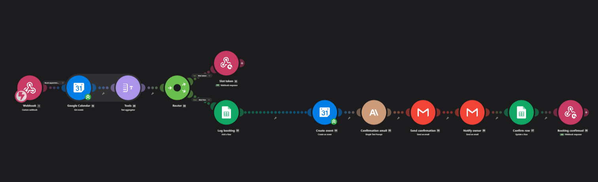

# Delua Studio — booking automation

Custom booking form + availability microservice + Make booking flow.



## System

| Part | What | Where |
|---|---|---|
| Booking form | Static HTML form (details, package, calendar, times, notes) | `delua-booking/index.html` |
| Availability API | FastAPI: Google Calendar reads, exact slot math, no AI | `delua-availability/` |
| Booking flow | Make scenario `Delua Studio – Appointment System` | Make team `My Team` |
| Agent skills | Make scenario skills for OpenCode | `.opencode/skills/` |

## Flow

```
Form → FastAPI reads → Make book → Calendar → emails
```

1. **Check (FastAPI, zero Make cost)** — form calls `GET /api/month`
   (full dates) and `GET /api/availability?date=&package=` (time pills).
   Rules: 09:00–18:00 Manila, hourly starts, Basic 60 min / Premium
   120 min, end by 18:00, 2 h same-day buffer, past dates empty.
2. **Book (Make webhook)** — `POST action=book`: overlap re-check
   (conflict JSON if taken) → Sheets row `Pending` → Calendar event
   (customer as attendee) → confirmation email to customer +
   short notify email (name/date/notes) to owner →
   Sheets `Confirmed` → `{"status":"ok","bookingId"}`.
3. Form shows loading overlay during submit, then the booking ID.

No `.ics` attachments and no Add-to-Calendar button (the attendee
invite already puts it on the customer's calendar — extras duplicate).

## Tools

- **Make** — booking scenario only; reads moved out to FastAPI.
  Skills in `.opencode/skills/` (`make-scenario-*`, `make-endpoints`);
  MCP server configured in `opencode.json`.
- **FastAPI service** — `pip install -r requirements.txt`,
  `uvicorn main:app --port 8000`; logic tests need no credentials:
  `python test_slots.py`. Needs `GOOGLE_SERVICE_ACCOUNT_JSON`,
  `CALENDAR_ID`, `ORIGINS` (see `delua-availability/.env.example`).

## Local dev

```
# form (http://localhost:8080)
cd delua-booking && python -m http.server 8080
# api (http://localhost:8000)
cd delua-availability && uvicorn main:app --port 8000
```

Form reads point at `CAL` (`localhost:8000/api` locally, service URL
in prod); book submit always posts to the Make webhook (`HOOK`).
